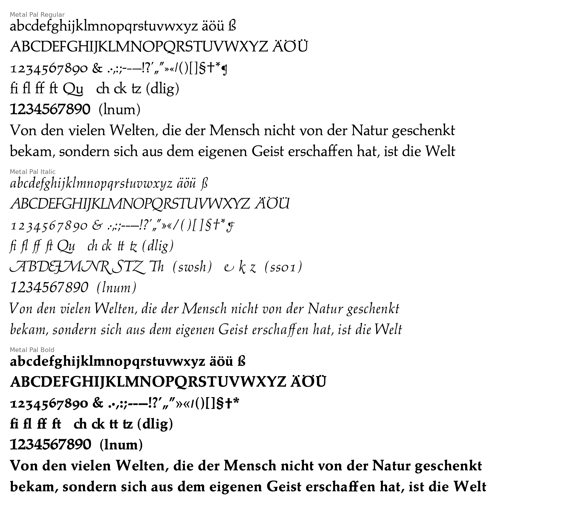

# Type revivals

Digital revivals of historical type, each in its own directory with its fonts, the tools that made them, and
notes on its sources.

| Directory | Fonts | Source |
|---|---|---|
| [`metal-pal/`](metal-pal/) | Metal Pal Regular, Italic, Bold | D. Stempel AG specimen cards of Hermann Zapf's foundry Palatino (1950–51) |

