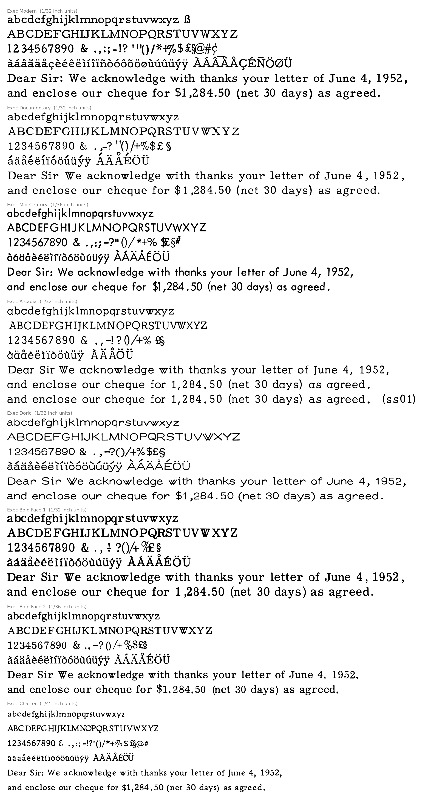
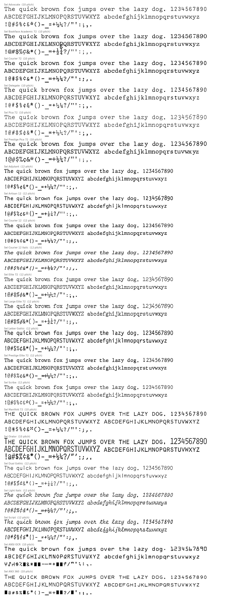

# Type revivals

Digital revivals of historical type, each in its own directory with its fonts, the tools that made them, and
notes on its sources.

| Directory | Fonts | Source |
|---|---|---|
| [`metal-pal/`](metal-pal/) | Metal Pal Regular, Italic, Bold | D. Stempel AG specimen cards of Hermann Zapf's foundry Palatino (1950–51) |
| [`ibm-selectric/`](ibm-selectric/) | Sel Courier 72, Prestige Elite 72, Letter Gothic, Orator, Script and 15 more, monospaced | IBM's Selectric typewriter type-style brochure (1972) |
| [`ibm-executive/`](ibm-executive/) | Exec Modern, Documentary, Mid-Century, Arcadia, Doric, Bold Face 1, Bold Face 2, Charter | Specimens of the IBM Executive proportional typewriter's faces (1950s) |

Every change to a font raises its version number; see [CONTRIBUTING.md](CONTRIBUTING.md).
