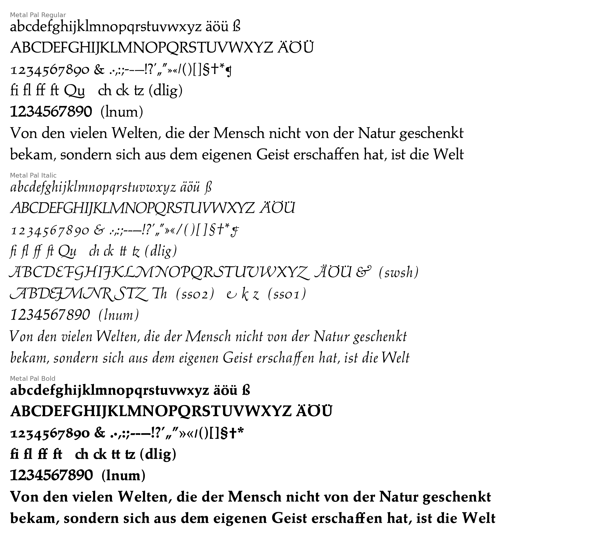
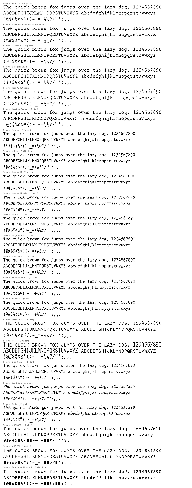

# Type revivals

Digital revivals of historical type, each in its own directory with its fonts, the tools that made them, and
notes on its sources.

| Directory | Fonts | Source |
|---|---|---|
| [`metal-pal/`](metal-pal/) | Metal Pal Regular, Italic, Bold | D. Stempel AG specimen cards of Hermann Zapf's foundry Palatino (1950–51) |
| [`executive/`](executive/) | Executive Modern, Documentary, Mid-Century, Arcadia, Doric, Bold Face 1, Bold Face 2, Charter, Secretarial, Registry, Text, Directory, Testimonial, Bold Face 1 Italic, Copperplate Gothic 1, Copperplate Gothic 2, Patron | Specimens of the Executive proportional typewriter's faces (IBM, 1950s) |
| [`selectric/`](selectric/) | Selectric Courier 72, Prestige Elite 72, Letter Gothic, Orator, Script, ANSI OCR and 17 more, monospaced | The Selectric typewriter's type-style brochure (IBM, 1972) |

Every change to a font raises its version number; see [CONTRIBUTING.md](CONTRIBUTING.md).
