# Type revivals

Digital revivals of historical type, each in its own directory with its fonts, the tools that made them, and
notes on its sources.

| Directory | Fonts | Source |
|---|---|---|
| [`metal-pal/`](metal-pal/) | Metal Pal Regular, Italic, Bold | D. Stempel AG specimen cards of Hermann Zapf's foundry Palatino (1950–51) |
| [`executive/`](executive/) | Executive Modern, Documentary, Mid-Century, Arcadia, Doric, Bold Face 1, Bold Face 2, Charter, Secretarial, Registry, Text, Directory, Testimonial, Bold Face 1 Italic, Copperplate Gothic 1, Copperplate Gothic 2, Patron | Specimens of the Executive proportional typewriter's faces (IBM, 1950s) |
| [`classic-mac/`](classic-mac/) | Athens HD, Chicago HD, Geneva HD, New York 12 HD, New York 24 HD, Monaco HD, New York 12 and 24 Mid HD | High-resolution recreations of the early Macintosh's bitmap fonts, on their metrics |
| [`selectric/`](selectric/) | Selectric Courier 72, Prestige Elite 72, Letter Gothic, Orator, Script, ANSI OCR and 17 more, monospaced | The Selectric typewriter's type-style brochure (IBM, 1972) |

<!-- downloads -->
## Download

### Metal Pal

**Metal Pal Regular**: [OTF](https://raw.githubusercontent.com/e-n-f/type-revivals/main/metal-pal/fonts/otf/MetalPal-Regular.otf) · [TTF](https://raw.githubusercontent.com/e-n-f/type-revivals/main/metal-pal/fonts/ttf/MetalPal-Regular.ttf)  
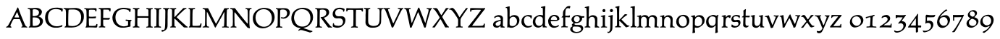

**Metal Pal Italic**: [OTF](https://raw.githubusercontent.com/e-n-f/type-revivals/main/metal-pal/fonts/otf/MetalPal-Italic.otf) · [TTF](https://raw.githubusercontent.com/e-n-f/type-revivals/main/metal-pal/fonts/ttf/MetalPal-Italic.ttf)  
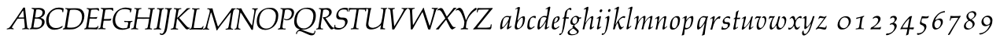

**Metal Pal Bold**: [OTF](https://raw.githubusercontent.com/e-n-f/type-revivals/main/metal-pal/fonts/otf/MetalPal-Bold.otf) · [TTF](https://raw.githubusercontent.com/e-n-f/type-revivals/main/metal-pal/fonts/ttf/MetalPal-Bold.ttf)  
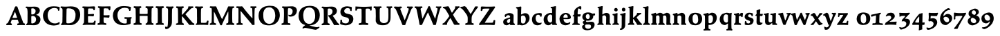

### Executive

**Executive Modern**: [OTF](https://raw.githubusercontent.com/e-n-f/type-revivals/main/executive/fonts/otf/ExecutiveModern-Regular.otf) · [TTF](https://raw.githubusercontent.com/e-n-f/type-revivals/main/executive/fonts/ttf/ExecutiveModern-Regular.ttf)  
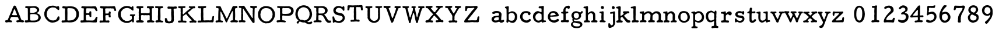

**Executive Documentary**: [OTF](https://raw.githubusercontent.com/e-n-f/type-revivals/main/executive/fonts/otf/ExecutiveDocumentary-Regular.otf) · [TTF](https://raw.githubusercontent.com/e-n-f/type-revivals/main/executive/fonts/ttf/ExecutiveDocumentary-Regular.ttf)  
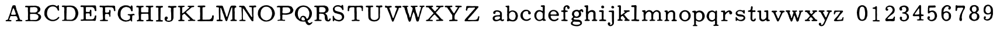

**Executive Mid-Century**: [OTF](https://raw.githubusercontent.com/e-n-f/type-revivals/main/executive/fonts/otf/ExecutiveMidCentury-Regular.otf) · [TTF](https://raw.githubusercontent.com/e-n-f/type-revivals/main/executive/fonts/ttf/ExecutiveMidCentury-Regular.ttf)  
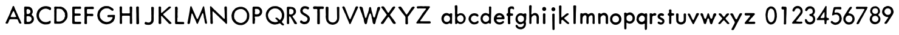

**Executive Arcadia**: [OTF](https://raw.githubusercontent.com/e-n-f/type-revivals/main/executive/fonts/otf/ExecutiveArcadia-Regular.otf) · [TTF](https://raw.githubusercontent.com/e-n-f/type-revivals/main/executive/fonts/ttf/ExecutiveArcadia-Regular.ttf)  
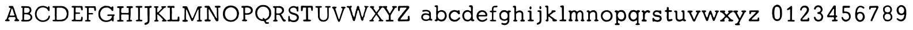

**Executive Doric**: [OTF](https://raw.githubusercontent.com/e-n-f/type-revivals/main/executive/fonts/otf/ExecutiveDoric-Regular.otf) · [TTF](https://raw.githubusercontent.com/e-n-f/type-revivals/main/executive/fonts/ttf/ExecutiveDoric-Regular.ttf)  
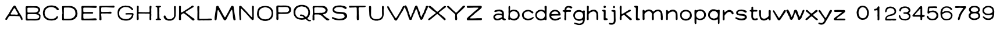

**Executive Bold Face 1**: [OTF](https://raw.githubusercontent.com/e-n-f/type-revivals/main/executive/fonts/otf/ExecutiveBoldFace1-Regular.otf) · [TTF](https://raw.githubusercontent.com/e-n-f/type-revivals/main/executive/fonts/ttf/ExecutiveBoldFace1-Regular.ttf)  

**Executive Bold Face 2**: [OTF](https://raw.githubusercontent.com/e-n-f/type-revivals/main/executive/fonts/otf/ExecutiveBoldFace2-Regular.otf) · [TTF](https://raw.githubusercontent.com/e-n-f/type-revivals/main/executive/fonts/ttf/ExecutiveBoldFace2-Regular.ttf)  
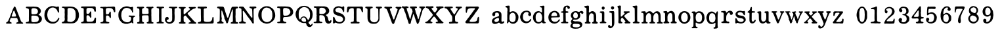

**Executive Charter**: [OTF](https://raw.githubusercontent.com/e-n-f/type-revivals/main/executive/fonts/otf/ExecutiveCharter-Regular.otf) · [TTF](https://raw.githubusercontent.com/e-n-f/type-revivals/main/executive/fonts/ttf/ExecutiveCharter-Regular.ttf)  
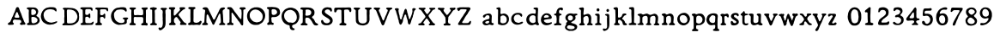

**Executive Secretarial**: [OTF](https://raw.githubusercontent.com/e-n-f/type-revivals/main/executive/fonts/otf/ExecutiveSecretarial-Regular.otf) · [TTF](https://raw.githubusercontent.com/e-n-f/type-revivals/main/executive/fonts/ttf/ExecutiveSecretarial-Regular.ttf)  
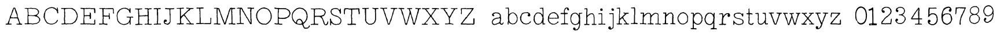

**Executive Registry**: [OTF](https://raw.githubusercontent.com/e-n-f/type-revivals/main/executive/fonts/otf/ExecutiveRegistry-Regular.otf) · [TTF](https://raw.githubusercontent.com/e-n-f/type-revivals/main/executive/fonts/ttf/ExecutiveRegistry-Regular.ttf)  
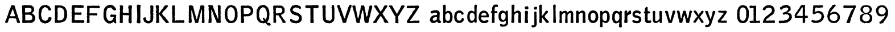

**Executive Text**: [OTF](https://raw.githubusercontent.com/e-n-f/type-revivals/main/executive/fonts/otf/ExecutiveText-Regular.otf) · [TTF](https://raw.githubusercontent.com/e-n-f/type-revivals/main/executive/fonts/ttf/ExecutiveText-Regular.ttf)  
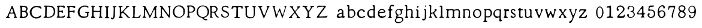

**Executive Directory**: [OTF](https://raw.githubusercontent.com/e-n-f/type-revivals/main/executive/fonts/otf/ExecutiveDirectory-Regular.otf) · [TTF](https://raw.githubusercontent.com/e-n-f/type-revivals/main/executive/fonts/ttf/ExecutiveDirectory-Regular.ttf)  
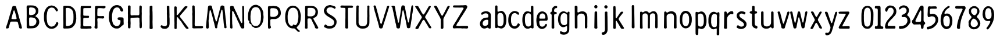

**Executive Testimonial**: [OTF](https://raw.githubusercontent.com/e-n-f/type-revivals/main/executive/fonts/otf/ExecutiveTestimonial-Regular.otf) · [TTF](https://raw.githubusercontent.com/e-n-f/type-revivals/main/executive/fonts/ttf/ExecutiveTestimonial-Regular.ttf)  
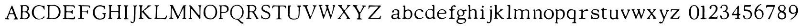

**Executive Bold Face 1 Italic**: [OTF](https://raw.githubusercontent.com/e-n-f/type-revivals/main/executive/fonts/otf/ExecutiveBoldFace1-Italic.otf) · [TTF](https://raw.githubusercontent.com/e-n-f/type-revivals/main/executive/fonts/ttf/ExecutiveBoldFace1-Italic.ttf)  
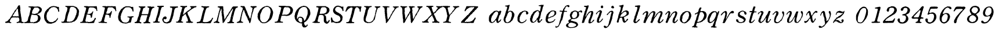

**Executive Copperplate Gothic 1**: [OTF](https://raw.githubusercontent.com/e-n-f/type-revivals/main/executive/fonts/otf/ExecutiveCopperplateGothic1-Regular.otf) · [TTF](https://raw.githubusercontent.com/e-n-f/type-revivals/main/executive/fonts/ttf/ExecutiveCopperplateGothic1-Regular.ttf)  
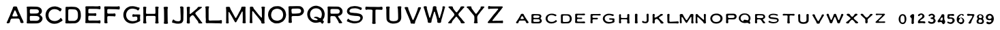

**Executive Copperplate Gothic 2**: [OTF](https://raw.githubusercontent.com/e-n-f/type-revivals/main/executive/fonts/otf/ExecutiveCopperplateGothic2-Regular.otf) · [TTF](https://raw.githubusercontent.com/e-n-f/type-revivals/main/executive/fonts/ttf/ExecutiveCopperplateGothic2-Regular.ttf)  
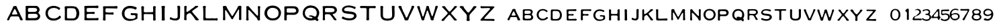

**Executive Patron**: [OTF](https://raw.githubusercontent.com/e-n-f/type-revivals/main/executive/fonts/otf/ExecutivePatron-Regular.otf) · [TTF](https://raw.githubusercontent.com/e-n-f/type-revivals/main/executive/fonts/ttf/ExecutivePatron-Regular.ttf)  
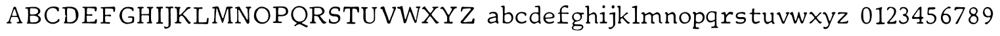

### Classic Mac

**Athens HD**: [OTF](https://raw.githubusercontent.com/e-n-f/type-revivals/main/classic-mac/fonts/otf/AthensHD-Regular.otf) · [TTF](https://raw.githubusercontent.com/e-n-f/type-revivals/main/classic-mac/fonts/ttf/AthensHD-Regular.ttf)  

**Chicago HD**: [OTF](https://raw.githubusercontent.com/e-n-f/type-revivals/main/classic-mac/fonts/otf/ChicagoHD-Regular.otf) · [TTF](https://raw.githubusercontent.com/e-n-f/type-revivals/main/classic-mac/fonts/ttf/ChicagoHD-Regular.ttf)  
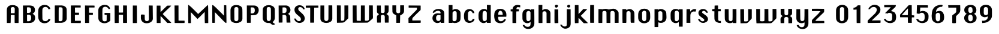

**Geneva HD**: [OTF](https://raw.githubusercontent.com/e-n-f/type-revivals/main/classic-mac/fonts/otf/GenevaHD-Regular.otf) · [TTF](https://raw.githubusercontent.com/e-n-f/type-revivals/main/classic-mac/fonts/ttf/GenevaHD-Regular.ttf)  

**Monaco HD**: [OTF](https://raw.githubusercontent.com/e-n-f/type-revivals/main/classic-mac/fonts/otf/MonacoHD-Regular.otf) · [TTF](https://raw.githubusercontent.com/e-n-f/type-revivals/main/classic-mac/fonts/ttf/MonacoHD-Regular.ttf)  
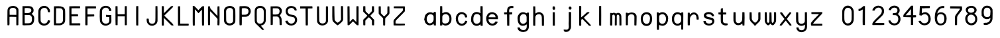

**New York 12 HD**: [OTF](https://raw.githubusercontent.com/e-n-f/type-revivals/main/classic-mac/fonts/otf/NewYork12HD-Regular.otf) · [TTF](https://raw.githubusercontent.com/e-n-f/type-revivals/main/classic-mac/fonts/ttf/NewYork12HD-Regular.ttf)  

**New York 24 HD**: [OTF](https://raw.githubusercontent.com/e-n-f/type-revivals/main/classic-mac/fonts/otf/NewYork24HD-Regular.otf) · [TTF](https://raw.githubusercontent.com/e-n-f/type-revivals/main/classic-mac/fonts/ttf/NewYork24HD-Regular.ttf)  

**New York 12 Mid HD**: [OTF](https://raw.githubusercontent.com/e-n-f/type-revivals/main/classic-mac/fonts/otf/NewYork12MidHD-Regular.otf) · [TTF](https://raw.githubusercontent.com/e-n-f/type-revivals/main/classic-mac/fonts/ttf/NewYork12MidHD-Regular.ttf)  

**New York 24 Mid HD**: [OTF](https://raw.githubusercontent.com/e-n-f/type-revivals/main/classic-mac/fonts/otf/NewYork24MidHD-Regular.otf) · [TTF](https://raw.githubusercontent.com/e-n-f/type-revivals/main/classic-mac/fonts/ttf/NewYork24MidHD-Regular.ttf)  

**New York 12 Blend HD**: [OTF](https://raw.githubusercontent.com/e-n-f/type-revivals/main/classic-mac/fonts/otf/NewYork12BlendHD-Regular.otf) · [TTF](https://raw.githubusercontent.com/e-n-f/type-revivals/main/classic-mac/fonts/ttf/NewYork12BlendHD-Regular.ttf)  

### Selectric

**Selectric Advocate**: [OTF](https://raw.githubusercontent.com/e-n-f/type-revivals/main/selectric/fonts/otf/SelectricAdvocate-Regular.otf) · [TTF](https://raw.githubusercontent.com/e-n-f/type-revivals/main/selectric/fonts/ttf/SelectricAdvocate-Regular.ttf)  
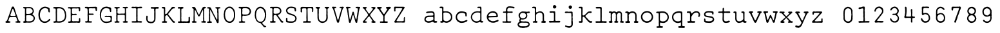

**Selectric Bookface Academic 72**: [OTF](https://raw.githubusercontent.com/e-n-f/type-revivals/main/selectric/fonts/otf/SelectricBookfaceAcademic72-Regular.otf) · [TTF](https://raw.githubusercontent.com/e-n-f/type-revivals/main/selectric/fonts/ttf/SelectricBookfaceAcademic72-Regular.ttf)  
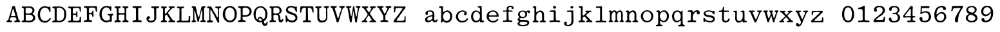

**Selectric Courier 72**: [OTF](https://raw.githubusercontent.com/e-n-f/type-revivals/main/selectric/fonts/otf/SelectricCourier72-Regular.otf) · [TTF](https://raw.githubusercontent.com/e-n-f/type-revivals/main/selectric/fonts/ttf/SelectricCourier72-Regular.ttf)  
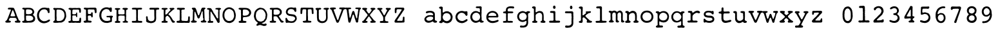

**Selectric Delegate**: [OTF](https://raw.githubusercontent.com/e-n-f/type-revivals/main/selectric/fonts/otf/SelectricDelegate-Regular.otf) · [TTF](https://raw.githubusercontent.com/e-n-f/type-revivals/main/selectric/fonts/ttf/SelectricDelegate-Regular.ttf)  
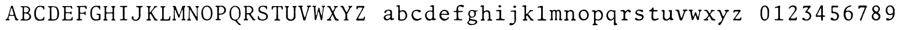

**Selectric Pica 72**: [OTF](https://raw.githubusercontent.com/e-n-f/type-revivals/main/selectric/fonts/otf/SelectricPica72-Regular.otf) · [TTF](https://raw.githubusercontent.com/e-n-f/type-revivals/main/selectric/fonts/ttf/SelectricPica72-Regular.ttf)  
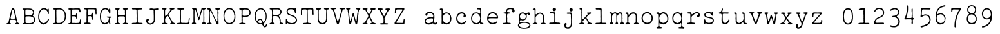

**Selectric Prestige Pica 72**: [OTF](https://raw.githubusercontent.com/e-n-f/type-revivals/main/selectric/fonts/otf/SelectricPrestigePica72-Regular.otf) · [TTF](https://raw.githubusercontent.com/e-n-f/type-revivals/main/selectric/fonts/ttf/SelectricPrestigePica72-Regular.ttf)  
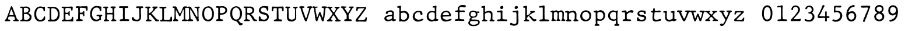

**Selectric Manifold 72**: [OTF](https://raw.githubusercontent.com/e-n-f/type-revivals/main/selectric/fonts/otf/SelectricManifold72-Regular.otf) · [TTF](https://raw.githubusercontent.com/e-n-f/type-revivals/main/selectric/fonts/ttf/SelectricManifold72-Regular.ttf)  
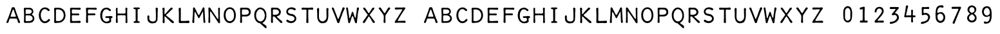

**Selectric Orator**: [OTF](https://raw.githubusercontent.com/e-n-f/type-revivals/main/selectric/fonts/otf/SelectricOrator-Regular.otf) · [TTF](https://raw.githubusercontent.com/e-n-f/type-revivals/main/selectric/fonts/ttf/SelectricOrator-Regular.ttf)  
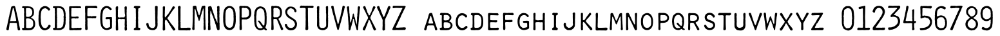

**Selectric ANSI OCR**: [OTF](https://raw.githubusercontent.com/e-n-f/type-revivals/main/selectric/fonts/otf/SelectricANSIOCR-Regular.otf) · [TTF](https://raw.githubusercontent.com/e-n-f/type-revivals/main/selectric/fonts/ttf/SelectricANSIOCR-Regular.ttf)  

**Selectric AN3 360**: [OTF](https://raw.githubusercontent.com/e-n-f/type-revivals/main/selectric/fonts/otf/SelectricAN3360-Regular.otf) · [TTF](https://raw.githubusercontent.com/e-n-f/type-revivals/main/selectric/fonts/ttf/SelectricAN3360-Regular.ttf)  
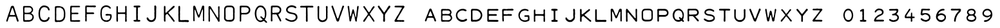

**Selectric Printing and Publishing 2**: [OTF](https://raw.githubusercontent.com/e-n-f/type-revivals/main/selectric/fonts/otf/SelectricPrintingPublishing2-Regular.otf) · [TTF](https://raw.githubusercontent.com/e-n-f/type-revivals/main/selectric/fonts/ttf/SelectricPrintingPublishing2-Regular.ttf)  
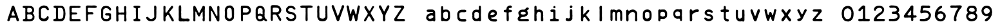

**Selectric Adjutant**: [OTF](https://raw.githubusercontent.com/e-n-f/type-revivals/main/selectric/fonts/otf/SelectricAdjutant-Regular.otf) · [TTF](https://raw.githubusercontent.com/e-n-f/type-revivals/main/selectric/fonts/ttf/SelectricAdjutant-Regular.ttf)  
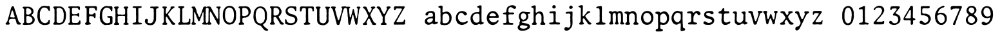

**Selectric Artisan 12**: [OTF](https://raw.githubusercontent.com/e-n-f/type-revivals/main/selectric/fonts/otf/SelectricArtisan12-Regular.otf) · [TTF](https://raw.githubusercontent.com/e-n-f/type-revivals/main/selectric/fonts/ttf/SelectricArtisan12-Regular.ttf)  
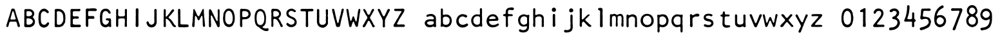

**Selectric Courier 12**: [OTF](https://raw.githubusercontent.com/e-n-f/type-revivals/main/selectric/fonts/otf/SelectricCourier12-Regular.otf) · [TTF](https://raw.githubusercontent.com/e-n-f/type-revivals/main/selectric/fonts/ttf/SelectricCourier12-Regular.ttf)  
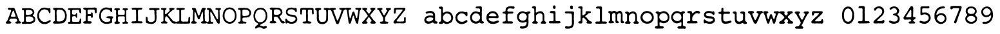

**Selectric Courier 12 Italic**: [OTF](https://raw.githubusercontent.com/e-n-f/type-revivals/main/selectric/fonts/otf/SelectricCourier12Italic-Italic.otf) · [TTF](https://raw.githubusercontent.com/e-n-f/type-revivals/main/selectric/fonts/ttf/SelectricCourier12Italic-Italic.ttf)  
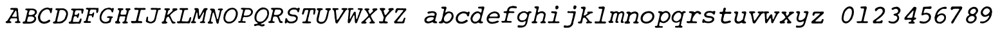

**Selectric Elite 72**: [OTF](https://raw.githubusercontent.com/e-n-f/type-revivals/main/selectric/fonts/otf/SelectricElite72-Regular.otf) · [TTF](https://raw.githubusercontent.com/e-n-f/type-revivals/main/selectric/fonts/ttf/SelectricElite72-Regular.ttf)  
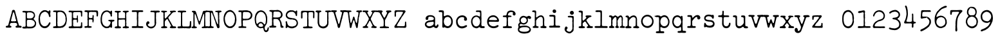

**Selectric Large Elite 72**: [OTF](https://raw.githubusercontent.com/e-n-f/type-revivals/main/selectric/fonts/otf/SelectricLargeElite72-Regular.otf) · [TTF](https://raw.githubusercontent.com/e-n-f/type-revivals/main/selectric/fonts/ttf/SelectricLargeElite72-Regular.ttf)  
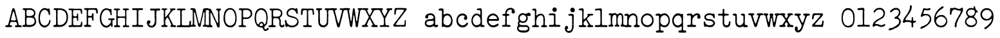

**Selectric Letter Gothic**: [OTF](https://raw.githubusercontent.com/e-n-f/type-revivals/main/selectric/fonts/otf/SelectricLetterGothic-Regular.otf) · [TTF](https://raw.githubusercontent.com/e-n-f/type-revivals/main/selectric/fonts/ttf/SelectricLetterGothic-Regular.ttf)  
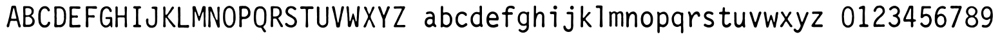

**Selectric Prestige Elite 72**: [OTF](https://raw.githubusercontent.com/e-n-f/type-revivals/main/selectric/fonts/otf/SelectricPrestigeElite72-Regular.otf) · [TTF](https://raw.githubusercontent.com/e-n-f/type-revivals/main/selectric/fonts/ttf/SelectricPrestigeElite72-Regular.ttf)  
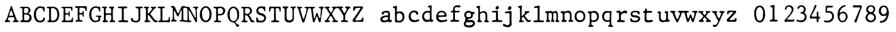

**Selectric Scribe**: [OTF](https://raw.githubusercontent.com/e-n-f/type-revivals/main/selectric/fonts/otf/SelectricScribe-Regular.otf) · [TTF](https://raw.githubusercontent.com/e-n-f/type-revivals/main/selectric/fonts/ttf/SelectricScribe-Regular.ttf)  
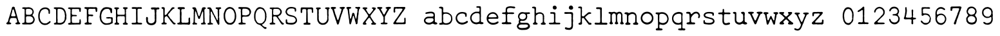

**Selectric Dual Gothic**: [OTF](https://raw.githubusercontent.com/e-n-f/type-revivals/main/selectric/fonts/otf/SelectricDualGothic-Regular.otf) · [TTF](https://raw.githubusercontent.com/e-n-f/type-revivals/main/selectric/fonts/ttf/SelectricDualGothic-Regular.ttf)  
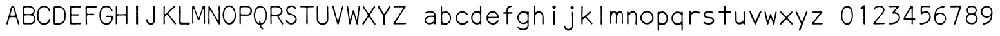

**Selectric Light Italic**: [OTF](https://raw.githubusercontent.com/e-n-f/type-revivals/main/selectric/fonts/otf/SelectricLightItalic-Italic.otf) · [TTF](https://raw.githubusercontent.com/e-n-f/type-revivals/main/selectric/fonts/ttf/SelectricLightItalic-Italic.ttf)  
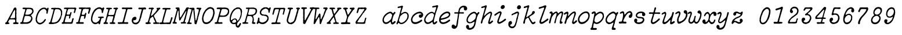

**Selectric Script Italic**: [OTF](https://raw.githubusercontent.com/e-n-f/type-revivals/main/selectric/fonts/otf/SelectricScript-Italic.otf) · [TTF](https://raw.githubusercontent.com/e-n-f/type-revivals/main/selectric/fonts/ttf/SelectricScript-Italic.ttf)  
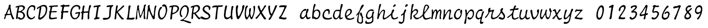

<!-- /downloads -->

Every change to a font raises its version number; see [CONTRIBUTING.md](CONTRIBUTING.md).
