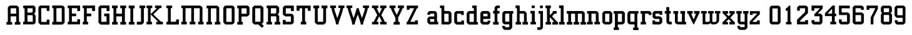
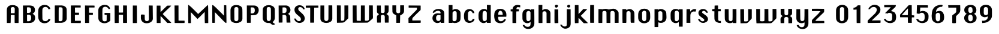
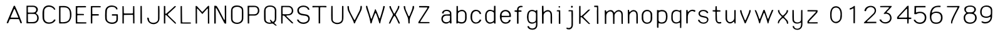
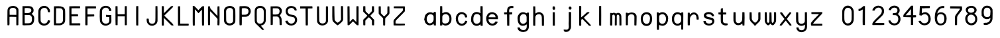
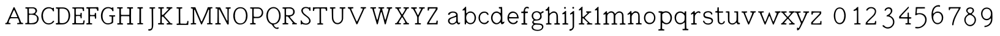
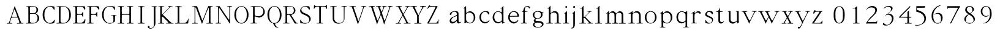
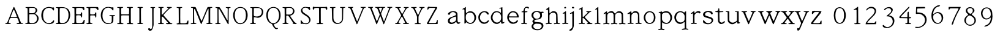
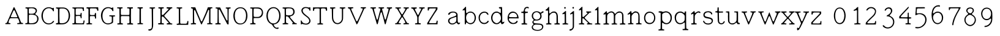
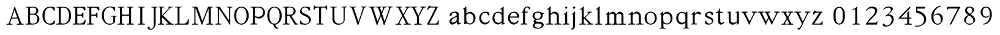

# Classic Mac

High-resolution recreations of the bitmap fonts of the early Macintosh, each drawn on its bitmap's own metrics:
set at the bitmap's point size, every character advances by exactly the bitmap's pixels, so text set in the
recreation lines up as the bitmap font set it.

| Font | Recreates | Version | Files |
|---|---|---|---|
| Athens HD | Athens 18 (Susan Kare, 1984) | 1.002 | `fonts/otf/AthensHD-Regular.otf`, `fonts/ttf/AthensHD-Regular.ttf` |
| Chicago HD | Chicago 12 (Susan Kare, 1984) | 1.002 | `fonts/otf/ChicagoHD-Regular.otf`, `fonts/ttf/ChicagoHD-Regular.ttf` |
| Geneva HD | Geneva 12 (Susan Kare, 1984) | 1.001 | `fonts/otf/GenevaHD-Regular.otf`, `fonts/ttf/GenevaHD-Regular.ttf` |
| New York 12 HD | New York 12 (Susan Kare, 1984) | 1.003 | `fonts/otf/NewYork12HD-Regular.otf`, `fonts/ttf/NewYork12HD-Regular.ttf` |
| New York 24 HD | New York 24 (Susan Kare, 1984) | 1.001 | `fonts/otf/NewYork24HD-Regular.otf`, `fonts/ttf/NewYork24HD-Regular.ttf` |
| Monaco HD | Monaco 12 (Susan Kare, 1984) | 1.003 | `fonts/otf/MonacoHD-Regular.otf`, `fonts/ttf/MonacoHD-Regular.ttf` |
| New York 12 Blend HD | New York 12 blended halfway to New York 24, on 12's spacing | 1.009 | `fonts/otf/NewYork12BlendHD-Regular.otf`, `fonts/ttf/NewYork12BlendHD-Regular.ttf` |
| New York 12 Mid HD | New York 12, at the weight halfway to New York 24's | 1.003 | `fonts/otf/NewYork12MidHD-Regular.otf`, `fonts/ttf/NewYork12MidHD-Regular.ttf` |
| New York 24 Mid HD | New York 24, at the weight halfway to New York 12's | 1.002 | `fonts/otf/NewYork24MidHD-Regular.otf`, `fonts/ttf/NewYork24MidHD-Regular.ttf` |

Each font is in `fonts/otf/` (cubic outlines, unhinted) and `fonts/ttf/` (quadratic, hinted with
[ttfautohint](https://freetype.org/ttfautohint/) at 8–50 px).

<!-- downloads -->
## Download

**Athens HD**: [OTF](https://raw.githubusercontent.com/e-n-f/type-revivals/main/classic-mac/fonts/otf/AthensHD-Regular.otf) · [TTF](https://raw.githubusercontent.com/e-n-f/type-revivals/main/classic-mac/fonts/ttf/AthensHD-Regular.ttf)  


**Chicago HD**: [OTF](https://raw.githubusercontent.com/e-n-f/type-revivals/main/classic-mac/fonts/otf/ChicagoHD-Regular.otf) · [TTF](https://raw.githubusercontent.com/e-n-f/type-revivals/main/classic-mac/fonts/ttf/ChicagoHD-Regular.ttf)  


**Geneva HD**: [OTF](https://raw.githubusercontent.com/e-n-f/type-revivals/main/classic-mac/fonts/otf/GenevaHD-Regular.otf) · [TTF](https://raw.githubusercontent.com/e-n-f/type-revivals/main/classic-mac/fonts/ttf/GenevaHD-Regular.ttf)  


**Monaco HD**: [OTF](https://raw.githubusercontent.com/e-n-f/type-revivals/main/classic-mac/fonts/otf/MonacoHD-Regular.otf) · [TTF](https://raw.githubusercontent.com/e-n-f/type-revivals/main/classic-mac/fonts/ttf/MonacoHD-Regular.ttf)  


**New York 12 HD**: [OTF](https://raw.githubusercontent.com/e-n-f/type-revivals/main/classic-mac/fonts/otf/NewYork12HD-Regular.otf) · [TTF](https://raw.githubusercontent.com/e-n-f/type-revivals/main/classic-mac/fonts/ttf/NewYork12HD-Regular.ttf)  


**New York 24 HD**: [OTF](https://raw.githubusercontent.com/e-n-f/type-revivals/main/classic-mac/fonts/otf/NewYork24HD-Regular.otf) · [TTF](https://raw.githubusercontent.com/e-n-f/type-revivals/main/classic-mac/fonts/ttf/NewYork24HD-Regular.ttf)  


**New York 12 Blend HD**: [OTF](https://raw.githubusercontent.com/e-n-f/type-revivals/main/classic-mac/fonts/otf/NewYork12BlendHD-Regular.otf) · [TTF](https://raw.githubusercontent.com/e-n-f/type-revivals/main/classic-mac/fonts/ttf/NewYork12BlendHD-Regular.ttf)  


**New York 12 Mid HD**: [OTF](https://raw.githubusercontent.com/e-n-f/type-revivals/main/classic-mac/fonts/otf/NewYork12MidHD-Regular.otf) · [TTF](https://raw.githubusercontent.com/e-n-f/type-revivals/main/classic-mac/fonts/ttf/NewYork12MidHD-Regular.ttf)  


**New York 24 Mid HD**: [OTF](https://raw.githubusercontent.com/e-n-f/type-revivals/main/classic-mac/fonts/otf/NewYork24MidHD-Regular.otf) · [TTF](https://raw.githubusercontent.com/e-n-f/type-revivals/main/classic-mac/fonts/ttf/NewYork24MidHD-Regular.ttf)  


<!-- /downloads -->

## Size and metrics

One bitmap pixel is 50 font units, and the em is the bitmap's point size in pixels, so each recreation set at
its bitmap's point size is the bitmap's size on a 72-dpi Mac screen:

| Font | Set at | Em | Ascender | Descender | Lines apart |
|---|---|---|---|---|---|
| Athens HD | 18 pt | 18 px, 900 units | 18 px, 900 units | 4 px, 200 units | 22 px |
| Chicago HD | 12 pt | 12 px, 600 units | 12 px, 600 units | 3 px, 150 units | 15 px |
| Geneva HD | 12 pt | 12 px, 600 units | 12 px, 600 units | 3 px, 150 units | 15 px |
| New York 12 HD, 12 Mid HD | 12 pt | 12 px, 600 units | 12 px, 600 units | 3 px, 150 units | 15 px |
| New York 24 HD, 24 Mid HD | 24 pt | 24 px, 1200 units | 21 px, 1050 units | 5 px, 250 units | 26 px |
| Monaco HD | 12 pt | 12 px, 600 units | 12 px, 600 units | 3 px, 150 units | 15 px |

Every advance width is the bitmap's, in whole pixels, and the line gap is none. There is no kerning, as the bitmaps
had none. Monaco HD is monospaced, and marked so: every character advances 7 pixels, 350 units. (The bitmap's `©` and `®`
advance 6; here they advance 7 like the rest, with their ink where the bitmap has it.)

Traced at their 50 % contour, the strokes come out the bitmap's exact width: Chicago's and Athens's stems are 2
pixels, the others' 1 (New York 24's 1 and 2). But antialiased outlines read darker than crisp pixels, more so
with macOS's font smoothing, so every font's strokes are thinned by 4 units a side (`LIGHTEN` in
`tools/build.py`), to about 1.8 pixels (0.8 for a 1-pixel stroke). Thinning would widen any small dent in
the traced ink into a notch, so dents narrower than the thinning are filled first.

## New York 12 and 24

New York 24 isn't New York 12 drawn larger: it is a different design, with finer strokes for its size. Traced
from their sheets, unthinned, the strokes of New York 12 average 0.0735 em and those of New York 24 0.0546 em;
thinned by 4 units a side, as New York 12 HD and 24 HD, 0.0601 em and 0.0479 em. New York 12 Mid HD and New
York 24 Mid HD are each at about the weight halfway between those two, 0.054 em, so that 12 Mid is lighter than
12 HD and 24 Mid heavier than 24 HD: New York 12 thinned by 6 units a side (of its em of 600), to 0.0537 em, and
New York 24 by 1 (of 1200), to 0.0529 em. Their metrics are New York 12's and 24's own.
New York 12's `a` came out of the upscaling taller than the other lower-case letters (from 7 to 343 units, where
`c e o` reach from 20 to 333), though its bitmap is as high as theirs: it is squeezed to 11 to 333, with its
accented forms and `æ` (`SQUEEZE` in `tools/build.py`).
[`specimen/newyork-weights.png`](specimen/newyork-weights.png) sets the four at one size.

### New York 12 Blend HD

**New York 12 Blend HD** (experimental) is New York 12 and 24 blended halfway, in raster space, with New York
12's advances and spacing exactly (`tools/sdfblend.py`). For each glyph, New York 24's is fitted onto New York
12's (across by their ink boxes; up and down, for letters, by the fonts' baselines, x-heights, cap heights,
ascenders and descenders, and for figures and signs by their boxes), then registered to it by a smooth
thin-plate spline through matched pairs, several rounds over: for letters, points of the two glyphs' ink edges
facing the same way, so that strokes' sides meet and their thickness and ends morph as shapes (square crossbar
ends stay square, serifs' feet stay on the baseline, crossbars meet at their heights); for figures and signs,
points of their centerlines, with stroke ends and edges on the guide lines held to each other. Dots and accents
are paired by their centres. Both glyphs' signed distance fields are warped to the shape halfway between them,
New York 24's kept near New York 12's (so that where the warp goes wrong it can't put ink in a counter, nor lose
an accent), and averaged and traced. Strokes take in-between thickness and contrast, and the shapes are halfway
between the two designs: New York 12's square serifs, forced by its pixels, round off, and its round o becomes
an oval with thick and thin. In the lower case, upright strokes are thickened a little across and stems thinned,
so that the sides of `o e c` are no lighter than the stems. A few glyphs need help: New York 24's two bars of `¢`
and `$` are run together to register with New York 12's one; `ª º`, set high, are fitted by their boxes; the
counter of `a` is smoothed where the two designs' joins differ; and `§ ™`, too unlike New York 24's to blend, are
New York 12's own at the blend's weight. W and w are made of two of the blended V and v (crossed near the top, as New York 24's W; joined, as New York
12's w). A glyph whose blend would come apart is blended less (`]` and `¶`). Every glyph holds
together. [`specimen/newyork-blend.png`](specimen/newyork-blend.png) sets it with New York 12 HD and 24 HD;
[`specimen/newyork-alphabets.png`](specimen/newyork-alphabets.png) sets the alphabets and figures in New York 12's
bitmap, 12 HD, the blend, 24 HD, 24's bitmap and Apple's 1991 TrueType New York (rendered from a copy of that
font, which isn't in this repository: `python3 tools/specimen.py path/to/New\ York.ttf`).

The centerlines it registers by (`tools/centerline.py`, in `centerlines/`) are each glyph's stroke skeleton,
spurs pruned, ends carried on to the stroke's end, and smoothed, every point with its left and right pen widths.
[`specimen/centerline-newyork.png`](specimen/centerline-newyork.png) shows them.

## Character set

Athens HD has every character of the bitmap: ASCII and the upper half of Mac OS Roman as Athens has it (the
accented letters, `† ° ¢ £ • ß ® © ™ ´ ¨ Æ Ø ¥ ª º æ ø ¿ ¡ « » … À Ã Õ Œ œ – — “ ” ‘ ’ ◊ ÿ`). Athens's `Ÿ`
(Mac OS Roman 0xD9) is a pair of paw prints, and stays so, at U+0178. The bitmap's other Mac OS Roman places
(`± ≤ ≥ µ ∂ ∑ ∏ π ∫ Ω √ ƒ ≈ ∆ ≠ ∞` and the like) are empty in Athens, so they are here too.

Chicago HD has more of Mac OS Roman: Athens's characters but its paw prints, and `§ ¶ ≠ ∞ ± ≤ ≥ µ ∂ ∑ ∏ π ∫ Ω ¬ √ ƒ
≈ ∆ ÷`.
Chicago's four menu symbols, at the control codes 0x11–0x14 on the Mac, are at their Unicode places: ⌘ U+2318,
✓ U+2713, ◆ U+25C6, and the Apple logo at U+F8FF, in the Private Use Area, where Apple's own fonts put it. The
logo is Apple's trademark. (The OS X `.dfont` keeps the four in Mac OS Roman's 0xD9–0xDC, the places of
`Ÿ ⁄ ¤ ‹`, which Chicago doesn't otherwise have.) Ω is both U+03A9 and U+2126, which Mac OS Roman's 0xBD
stood for.

Geneva HD and Monaco HD have Chicago's characters, but in place of its menu symbols, a joke of Susan Kare's at
`Ÿ` (U+0178), as Athens has its paw prints: Geneva's is a rabbit, Monaco's a candle. New York HD has Athens's
characters and `§ ¶`, and a robot at `Ÿ`; New York 24 HD the same. Ω is at both U+03A9 and U+2126 wherever the bitmap has it.

Monaco's `©` and `®` are cut off on the left, in the bitmap as here: the bitmap has the right-hand part of
each circle only.

`specimen/compare-<font>.png` ([Athens](specimen/compare-athens.png), [Chicago](specimen/compare-chicago.png),
[Geneva](specimen/compare-geneva.png), [New York 12](specimen/compare-newyork12.png),
[New York 24](specimen/compare-newyork24.png),
[Monaco](specimen/compare-monaco.png)) sets every character over its bitmap (pink), with its advance width
underlined.

## How the fonts are made

Everything is under `tools/` and runs from this directory (`classic-mac/`). The sources are in `scans/`, and
[`scans/README.md`](scans/README.md) says where each came from.

It needs Python 3 with the packages in `requirements.txt`, and the DejaVu fonts (`fonts-dejavu` on Debian and
Ubuntu) at `/usr/share/fonts/truetype/dejavu/` for the specimen's label.

```bash
pip install -r requirements.txt
python3 tools/build.py       # fonts/otf, fonts/ttf (about a minute)
python3 tools/specimen.py    # specimen/
python3 ../scripts/font_links.py   # the download lists and their specimen lines
```

1. **The sheet.** `scans/<font>-upscaled.png` is the bitmap font's characters laid out in lines, upscaled to
   36 times its pixels: first to 6 times by
   [bitmap-upscaling](https://github.com/e-n-f/bitmap-upscaling) (each character averaged over the many phases it
   was rendered at), then 6 times again by an AI upscaler. `scans/<font>-glyphs.json`, from the same project,
   says where each character is on the sheet: its cell, its origin (pen position on the baseline) and the
   bitmap's advance, in the coordinates of the 6-times sheet.
2. **Tracing** (`tools/build.py`, with `common/trace.py`). Each character's ink is cut from its cell, with two
   pixels round it for a character that reaches a little past its cell, keeping the pieces of ink that lie mostly
   inside the cell (a neighbour's can reach into it), and no further across than halfway to its neighbours on the
   line, for characters that touch on the sheet (New York's `w x y`). It is scaled to font units and traced at its 50 % contour.
3. **Placing.** Each outline is placed by its origin, and given the bitmap's advance. The bitmap font itself
   (`scans/*.dfont`, read by `tools/bitmap.py`) gives the space's width and the
   ascender and descender.
4. **Accents.** Where the sheet has a wrong accent over a letter (Geneva's `á à ä é ï`, Monaco's `à`: `REACCENT` in
   `tools/build.py`), the accent is taken from another letter whose bitmap has the same accent, pixel for pixel,
   and set where the bitmap has it.
5. **Other repairs.** A few characters the AI upscaler got wrong are traced from bitmap-upscaling's 6-times sheet
   instead (`scans/<font>-6x.png`, `SIX`): New York 24's comma (a dagger on the upscaled sheet), its `™` (a TH)
   and its `À` (a dot for the grave). New York 24's dieresis dots are single pixels, which the upscaler drew
   faint or lost, so each is a round dot a pixel across, at its pixel (`DOTS`).
