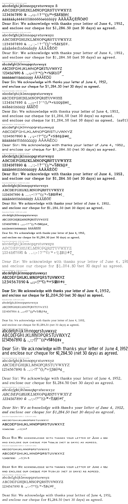
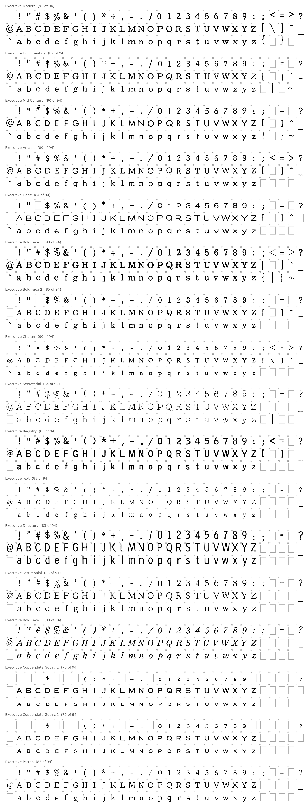

# Executive

Digital fonts traced from the type of the **Executive**, the proportional-spacing electric typewriter IBM
introduced in 1944. Unlike an ordinary typewriter, which moves the same distance for every letter, the Executive
gives each character a whole number of units: 2 for an i, 3 for an a, 4 for a capital H, 5 for an m. The fonts
keep those widths exactly, so text set in them falls where the machine would have put it.



| Font | IBM's name | Unit | Sources | Files |
|---|---|---|---|---|
| Executive Modern | Modern (Monotype series 602) | 1/32 inch | Jowa "IBM Executive 602" card; Finnish brochure; typed keyboard sheet | `ExecutiveModern-Regular` |
| Executive Documentary | Documentary | 1/32 inch | Finnish brochure | `ExecutiveDocumentary-Regular` |
| Executive Mid-Century | Mid-Century | 1/36 inch | Finnish brochure; ASA letter of 1962 | `ExecutiveMidCentury-Regular` |
| Executive Arcadia | Arcadia | 1/32 inch | Finnish brochure; E. T. News Letter of 1955 | `ExecutiveArcadia-Regular` |
| Executive Doric | Doric | 1/32 inch | Finnish brochure | `ExecutiveDoric-Regular` |
| Executive Bold Face 1 | Bold Face #1 | 1/32 inch | Finnish brochure | `ExecutiveBoldFace1-Regular` |
| Executive Bold Face 2 | Bold Face #2 | 1/36 inch | Finnish brochure | `ExecutiveBoldFace2-Regular` |
| Executive Charter | Charter | 1/45 inch | Finnish brochure; BCD code table of 1962 | `ExecutiveCharter-Regular` |
| Executive Secretarial | Secretarial | 1/32 inch | 1972 catalogue; R. W. Bemer's memo of 1961 | `ExecutiveSecretarial-Regular` |
| Executive Registry | Registry | 1/36 inch | E. T. News Letter of 1955; 1972 catalogue | `ExecutiveRegistry-Regular` |

Each font is in `fonts/otf/` (cubic outlines, unhinted) and `fonts/ttf/` (quadratic, hinted with
[ttfautohint](https://freetype.org/ttfautohint/) at 8–50 px). The versions are Executive Modern and Mid-Century 1.005;
Doric, Bold Face 2 and Charter 1.006; Documentary, Bold Face 1 and Arcadia 1.007; Secretarial and Registry
1.000. Every face takes its w and W
(where nothing better has them) and its letters' widths from IBM's 1972 catalogue. The sources are listed in
[`scans/README.md`](scans/README.md).

## Size and spacing

The fonts have 200 font units to the 1/32-inch unit, so 6400 to the inch. At 1000 units to the em, **set at
11.25 pt they print at the typewriter's own size**. The 1/36-inch faces' unit is 6400/36 = 177.8 font units and
the 1/45-inch face's 142.2. Each advance is its whole number of units, rounded to the nearest font unit.

The word space is 2 units in every face, measured from the gaps between words on the brochure. (The Jowa card is
justified foundry type, so its spaces vary.) The line spacing is the Executive's single spacing, six lines to the
inch (1067 font units).

There is no kerning, because the machine had none. Each glyph sits in its slug where the scans put it: the fit
gives every character an offset from the centre of its slug, as well as its width. A character seen in fewer
than four neighbour pairs (most signs, which the brochure types once each, beside other signs) is centred
instead: with so few pairs its offset trades against its width and can come out a whole unit off.

## Character set



The chart shows each font's printable ASCII (0x21–0x7E) in code order. A character a font lacks is an empty box.

- **Executive Modern** has everything on the Jowa card: a–z, A–Z, ä ö ü Ä Ö Ü ß ç Ç ø Ø, the figures,
  `& . , - : ; ! ? ( ) / " » « ' * + % $ £`. It also has `` ` ´ § `` from the brochure's Modern and
  `@ # ¢ _` from the typed keyboard sheet.
- **The brochure faces** have what the Finnish brochure shows: a–z and A–Z without w and W, å ä ö ü Å Ä Ö, the
  figures, `. , -` and the symbols the brochure prints for each face (`+ § = % ? & ( ) / £` and some of
  `! $ " ` ´`). Documentary's `` ` `` and Arcadia's `´` printed too faintly to trace.
- **Executive Mid-Century** also has `w W : ; " *` from a letter typed in it,
  and **Executive Charter** has `W [ ] < > ; : * ' # @ ! \` from a code table typed in it.
- **Executive Arcadia** has the two-storey a, w, W and `: ; ' " @ # $ ¢ * _` from IBM's 1955 newsletter that announced
  the face, typed in it. Its **`ss01`** (also in `salt`) gives the brochure's one-storey a, with à ä å.
- **w and W from IBM's catalogue.** The brochure comes from a Finnish alphabet, without w or W. Documentary,
  Doric, Bold Face 1 and 2 and Charter's w take theirs from IBM's 1972 catalogue. Each is scaled so the
  catalogue's letters are as tall as the brochure's, and thickened by the difference between the two sources'
  n m h u stems, because the catalogue is a crisp print and the brochure's halftone spreads the ink. The
  thickening is kept to the strokes: the glyph is scaled back to its height and width.
- **Accented letters are put together** from the face's own letters and accents, for every accent the scans show.
  Each accent is averaged over all the letters that carry it, and placed at its average offset from the
  letter's centre. Modern composes à á â ã ä å è é ê ë ì í î ï ñ ò ó ô õ ö ù ú û ü ý ÿ and their capitals. The
  brochure faces compose ä å ö ü, á à é è ë í ì ï ó ò ú ù ý ÿ, Å Ä Ö Ü and Á À É È Ó Ò Ú Ù Ý where the face shows
  the acute and grave. A capital's accent missing from a scan is the lower-case one, raised by the difference
  between the cap height and the x-height. ç Ç ø Ø ß are traced as printed. ¨ ´ ` are also spacing glyphs.
- **More of ASCII from IBM's catalogue.** Characters a font still lacked are traced from the catalogue's
  cells, chosen by eye among the candidates `catalog.py survey` finds (`CHOSEN` in `tools/catalog.py`):
  Modern `= ^`; Documentary `! # ' * : ; = [ ] _`; Mid-Century `! ' # @ [ ] { } ^ ~`; Arcadia `< > [ ] ^`;
  Doric `! " ' * : ; [ ] ^`; Bold Face 1 `" # $ ' * : ; @ ^`; Bold Face 2 `! " ' * : ; [ ] ^`; Charter `" ^ _`.
  The catalogue has no `\` or `|` for any of the faces, and `{ } ~` and `< >` only where listed.
- **Executive Secretarial and Registry** have no brochure line. Secretarial's letters and signs are the 1972
  catalogue's single prints (`CHOSEN` in `tools/catalog.py`), because the memo typed in it is a faint photocopy
  whose letters are broken; the memo gives its unit, 1/32 inch, and its word space. It has no 1 or 0 (its
  keyboard had none: the `1` and `0` keys type the l and the O, as typists did). Registry's characters are the
  1955 newsletter's typed prints, which give its unit, 1/36 inch, with the catalogue filling in `= + [ ] < ½ ¼`.
  The newsletter's line of signs is read by hand-listed columns (`TYPED_COLUMNS`): its `@#` and `*(` touch, its
  `%` prints in two pieces, and its `_` didn't print. Both faces take their letters' widths from the catalogue.
  Neither has accented letters, which none of their sources show.
- `)` is the `(` turned round in Modern, whose card has only the `(`. The typographic quotes ‘ ’ “ ” map to the
  typewriter's straight `'` and `"`.

## How the fonts are made

Everything is under `tools/` and runs from this directory (`executive/`). The scans aren't in the
repository: see [`scans/README.md`](scans/README.md) for where to get them.

```bash
python3 tools/read.py        # build/occ-<Face>.pkl: every character of every source line, matched to its text
python3 tools/units.py       # build/units-<Face>.json: the unit widths and slug offsets
python3 tools/build.py       # fonts/otf, fonts/ttf
python3 tools/specimen.py    # specimen/
```

1. **Reading** (`read.py`, with the line texts and positions in `sources.py`). Every line of the sources has a
   known text. Each line's ink is cut into groups of touching components and matched to its characters. Groups
   that print touching are split at their narrowest column, and characters in pieces are joined. The
   brochure's symbol lines have their columns listed by hand (`SYMBOL_COLUMNS`), because their symbols print
   once each and some are in pieces (`%`) or touch (Charter's `=%`).
2. **Unit widths** (`units.py`). Within a word, the distance between two neighbours' centres is half the sum of
   their widths, plus the difference of their offsets in their slugs. All the neighbour pairs of a face give a
   least-squares fit of the widths. The unit is the pitch that makes them whole numbers, with i, l, j at 2 units.
   The 1/32, 1/36 and 1/45-inch escapements are told apart against the brochure's Modern, which is 1/32. A
   character seen in fewer than four pairs takes the 1/32-inch faces' common table (Modern's), unless it is a
   letter whose fit lands on a whole unit. Arcadia's capitals F J L P R Y Z are narrower than the other faces'.
   The typed pages' unit in pixels is fitted from pairs of letters whose widths the face's table has, and the
   new characters' widths from their pairs with those. Pairs with a parenthesis are left out, because the
   typist spaced them, "( : )". A character with no usable pair takes its width from its ink and the face's
   fitted margin. The typed pages are scaled so their letters are as tall as the brochure's, which prints a
   few per cent smaller (its halftone thins the ink). A character from a second source (a typed page or the
   catalogue) is also moved up or down to the brochure's baseline: each of its lines is moved by the median
   difference between the heights of its characters and the same characters in the brochure, because a line
   of signs has few letters to find its baseline by. A `$` is then moved so its centre of mass is its face's
   `S`'s, since its S-shaped body is most of its ink and its bar reaches about as far above as below.
3. **Averaging and tracing** (`glyphs.py`, `build.py`, `common/trace.py`). Every occurrence of a character is
   scaled to font units and aligned to the others by phase correlation. The occurrences are averaged, which
   cancels most of the ribbon's and the paper's noise, and the 50 % ink contour is traced into Bézier curves.

**IBM's widths.** IBM's "Type Available" catalogue of January 1972 (form 1268416) shows every face's characters
in a grid, each with its width in units printed beside it. `tools/catalog.py` reads each face's alphabet from it.
Each cell's letter is identified against the face's font, because the grid's order varies: Documentary has T
before S. Each cell's width digit is read against templates. Of the fitted widths, all but three agree with
IBM's: Documentary's Y is 4, not 5; Arcadia's A is 3, not the 4 of the common table; and Charter's O is 4, not
3. The build takes all 52 letters' widths from the catalogue. Each face's punctuation widths were read from its
pages too (`READ_BY_EYE` for Arcadia, `WIDTHS` for the others), where the cells agree. Most often the period
and comma are 3 units where the fits gave 2 (a period is nearly always followed by a space, so the pairs saw
only one side of it), `/` is 3 rather than 2, and `?` 4 rather than 3. A character can appear in several cells
with different widths, for different keyboard arrangements; the widths taken are the ones its cells agree on.

The fitted widths also agree with IBM's own table, typed in Bold Face #1 on the sheet `typed-bold-face-1-units.jpg`
("flitj;': 2 units; qeryuopasdghkzxcvbnSJ!#$¢*"_: 3 units; …: 4 units; mWM: 5 units"). The exceptions are the `!`,
fitted at 2 units, and the `I`, which the sheet lists among the 4-unit capitals of its keyboard row but which is
2 units in every face here. The sheet gives the widths of `# ¢ _` (3 units). The keyboard sheet's own positions are too
rough to measure them, so it is used only for their shapes, scaled so its figures are as tall as the Jowa card's.

## Arcadia's a

The brochure's Arcadia has a one-storey a, but the face was announced in 1955 (IBM's E. T. News Letter No.
16) with a two-storey a. IBM's "Type designs" sheet and its 1972 catalogue show the two-storey a too, and the
catalogue lists the one-storey a among Arcadia's alternates (part 1112308). So Executive Arcadia's a is the
two-storey one, and the brochure's is `ss01`.

## Not yet done

- The catalogue shows every face's alternates too (other forms of letters, figures and signs, fractions,
  accented capitals); only what ASCII needs is taken from it so far.
- A memo by R. W. Bemer (7 November 1961), offered as Arcadia, is in IBM's **Secretarial**: the same wide
  monoline slab serif as the "Type designs" sheet's Secretarial sample (ball-terminal r and c, curve-tailed y,
  plain slab-footed f). It is one of Executive Secretarial's sources.
- The 1972 catalogue also shows Text, Bold Face Italic, Heritage, Directory, Testimonial, Copperplate Gothic 2,
  Patron and Registry No. 2, one print of each character, and Copperplate Gothic 1's signs.
- The brochure is a halftone print at about 13 px to the unit, so the brochure faces are softer than Modern,
  which is traced from a 9983-px photograph of the Jowa card (36 px to the unit).
- Modern's `† [ ] =` and em dash, shown on the Science Museum's 602 specimen, are in tiles too small to trace.
- The other Executive faces (Heritage, Directory, Bold Face Italic, Patron, …) aren't made yet.
