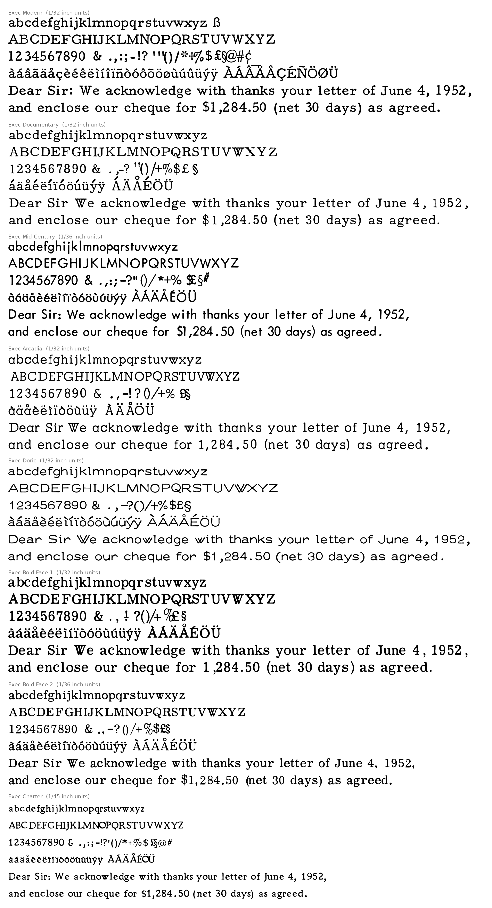

# Exec

Digital fonts traced from the type of the **IBM Executive**, the proportional-spacing electric typewriter IBM
introduced in 1944. Unlike an ordinary typewriter, which moves the same distance for every letter, the Executive
gives each character a whole number of units: 2 for an i, 3 for an a, 4 for a capital H, 5 for an m. The fonts
keep those widths exactly, so text set in them falls where the machine would have put it.



| Font | IBM's name | Unit | Sources | Files |
|---|---|---|---|---|
| Exec Modern | Modern (Monotype series 602) | 1/32 inch | Jowa "IBM Executive 602" card; Finnish brochure; typed keyboard sheet | `ExecModern-Regular` |
| Exec Documentary | Documentary | 1/32 inch | Finnish brochure | `ExecDocumentary-Regular` |
| Exec Mid-Century | Mid-Century | 1/36 inch | Finnish brochure; ASA letter of 1962 | `ExecMidCentury-Regular` |
| Exec Arcadia | Arcadia | 1/32 inch | Finnish brochure | `ExecArcadia-Regular` |
| Exec Doric | Doric | 1/32 inch | Finnish brochure | `ExecDoric-Regular` |
| Exec Bold Face 1 | Bold Face #1 | 1/32 inch | Finnish brochure | `ExecBoldFace1-Regular` |
| Exec Bold Face 2 | Bold Face #2 | 1/36 inch | Finnish brochure | `ExecBoldFace2-Regular` |
| Exec Charter | Charter | 1/45 inch | Finnish brochure; BCD code table of 1962 | `ExecCharter-Regular` |

Each font is in `fonts/otf/` (cubic outlines, unhinted) and `fonts/ttf/` (quadratic, hinted with
[ttfautohint](https://freetype.org/ttfautohint/) at 8–50 px), version 1.000. The sources are listed in
[`scans/README.md`](scans/README.md).

## Size and spacing

The fonts have 200 font units to the 1/32-inch unit, so 6400 to the inch. At 1000 units to the em, **set at
11.25 pt they print at the typewriter's own size**. The 1/36-inch faces' unit is 6400/36 = 177.8 font units and
the 1/45-inch face's 142.2. Each advance is its whole number of units, rounded to the nearest font unit.

The word space is 2 units in every face, measured from the gaps between words on the brochure. (The Jowa card is
justified foundry type, so its spaces vary.) The line spacing is the Executive's single spacing, six lines to the
inch (1067 font units).

There is no kerning, because the machine had none. Each glyph sits in its slug where the scans put it: the fit
gives every character an offset from the centre of its slug, as well as its width.

## Character set

- **Exec Modern** has everything on the Jowa card: a–z, A–Z, ä ö ü Ä Ö Ü ß ç Ç ø Ø, the figures,
  `& . , - : ; ! ? ( ) / " » « ' * + % $ £`. It also has `` ` ´ § `` from the brochure's Modern and
  `@ # ¢ _` from the typed keyboard sheet.
- **The brochure faces** have what the Finnish brochure shows: a–z and A–Z without w and W, å ä ö ü Å Ä Ö, the
  figures, `. , -` and the symbols the brochure prints for each face (`+ § = % ? & ( ) / £` and some of
  `! $ " ` ´`). Documentary's `` ` `` and Arcadia's `´` printed too faintly to trace.
- **Exec Mid-Century** also has `w W : ; " # *` from a letter typed in it (the `#` small and raised, as typed),
  and **Exec Charter** has `W [ ] < > ; : * ' # @ ! \` from a code table typed in it.
- **w and W are stand-ins** where no typed page shows them: in Documentary, Arcadia, Doric, Bold Face 1 and 2,
  and Charter's w. The brochure comes from a Finnish alphabet. Each stand-in is two overlapped v's (V's), spaced
  so the letter is as much wider than the v as Modern's w is (Modern: v 3, w 4, V 4, W 5 units).
- **Accented letters are put together** from the face's own letters and accents, for every accent the scans show.
  Each accent is averaged over all the letters that carry it, and placed at its average offset from the
  letter's centre. Modern composes à á â ã ä å è é ê ë ì í î ï ñ ò ó ô õ ö ù ú û ü ý ÿ and their capitals. The
  brochure faces compose ä å ö ü, á à é è ë í ì ï ó ò ú ù ý ÿ, Å Ä Ö Ü and Á À É È Ó Ò Ú Ù Ý where the face shows
  the acute and grave. A capital's accent missing from a scan is the lower-case one, raised by the difference
  between the cap height and the x-height. ç Ç ø Ø ß are traced as printed. ¨ ´ ` are also spacing glyphs.
- `)` is the `(` turned round in Modern, whose card has only the `(`. The typographic quotes ‘ ’ “ ” map to the
  typewriter's straight `'` and `"`.

## How the fonts are made

Everything is under `tools/` and runs from this directory (`ibm-executive/`). The scans aren't in the
repository: see [`scans/README.md`](scans/README.md) for where to get them.

```bash
python3 tools/read.py        # build/occ-<Face>.pkl: every character of every source line, matched to its text
python3 tools/units.py       # build/units-<Face>.json: the unit widths and slug offsets
python3 tools/build.py       # fonts/otf, fonts/ttf
python3 tools/specimen.py    # specimen/
```

1. **Reading** (`read.py`, with the line texts and positions in `sources.py`). Every line of the sources has a
   known text. Each line's ink is cut into groups of touching components and matched to its characters. Groups
   that print touching are split at their narrowest column, and characters in pieces are joined. The
   brochure's symbol lines have their columns listed by hand (`SYMBOL_COLUMNS`), because their symbols print
   once each and some are in pieces (`%`) or touch (Charter's `=%`).
2. **Unit widths** (`units.py`). Within a word, the distance between two neighbours' centres is half the sum of
   their widths, plus the difference of their offsets in their slugs. All the neighbour pairs of a face give a
   least-squares fit of the widths. The unit is the pitch that makes them whole numbers, with i, l, j at 2 units.
   The 1/32, 1/36 and 1/45-inch escapements are told apart against the brochure's Modern, which is 1/32. A
   character seen in fewer than four pairs takes the 1/32-inch faces' common table (Modern's), unless it is a
   letter whose fit lands on a whole unit. Arcadia's capitals F J L P R Y Z are narrower than the other faces'.
   The typed pages' unit in pixels is fitted from pairs of letters whose widths the face's table has, and the
   new characters' widths from their pairs with those. Pairs with a parenthesis are left out, because the
   typist spaced them, "( : )". A character with no usable pair takes its width from its ink and the face's
   fitted margin. The typed pages are scaled so their letters are as tall as the brochure's, which prints a
   few per cent smaller (its halftone thins the ink).
3. **Averaging and tracing** (`glyphs.py`, `build.py`, `common/trace.py`). Every occurrence of a character is
   scaled to font units and aligned to the others by phase correlation. The occurrences are averaged, which
   cancels most of the ribbon's and the paper's noise, and the 50 % ink contour is traced into Bézier curves.

The fitted widths agree with IBM's own table, typed in Bold Face #1 on the sheet `typed-bold-face-1-units.jpg`
("flitj;': 2 units; qeryuopasdghkzxcvbnSJ!#$¢*"_: 3 units; …: 4 units; mWM: 5 units"). The exceptions are the `!`,
fitted at 2 units, and the `I`, which the sheet lists among the 4-unit capitals of its keyboard row but which is
2 units in every face here. The sheet gives the widths of `# ¢ _` (3 units). The keyboard sheet's own positions are too
rough to measure them, so it is used only for their shapes, scaled so its figures are as tall as the Jowa card's.

## Not yet done

- Arcadia has no real w or W. A memo by R. W. Bemer (7 November 1961) offered for it is in another face: a
  slab serif with a two-storey a, not the brochure's monoline Arcadia with its one-storey a.
- The brochure is a halftone print at about 13 px to the unit, so the brochure faces are softer than Modern,
  which is traced from a 9983-px photograph of the Jowa card (36 px to the unit).
- Modern's `† [ ] =` and em dash, shown on the Science Museum's 602 specimen, are in tiles too small to trace.
- Other IBM Executive faces (Heritage, Secretarial, Directory, Bold Face Italic, …), shown on the "Type designs"
  sheets, aren't made yet.
