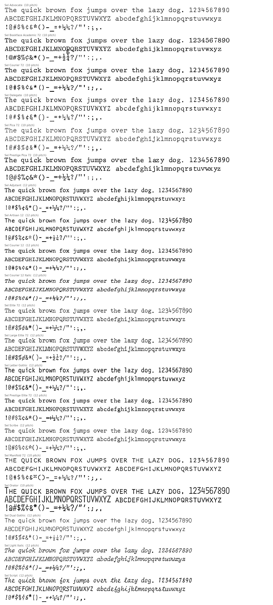
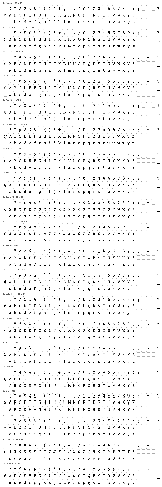

# Sel

Digital fonts traced from the type of the **IBM Selectric** typewriter, as IBM's type-style brochure of 1972
shows it, in two printings. Every Selectric character is the same width: 1/10 inch on a 10-pitch element, 1/12 inch on a 12-pitch
one. The fonts are monospaced to match, so text set in them lines up as it did on the machine.



| Font | Pitch | Font | Pitch |
|---|---|---|---|
| Sel Advocate | 10 | Sel Courier 12 | 12 |
| Sel Bookface Academic 72 | 10 | Sel Courier 12 Italic | 12 |
| Sel Courier 72 | 10 | Sel Elite 72 | 12 |
| Sel Delegate | 10 | Sel Large Elite 72 | 12 |
| Sel Pica 72 | 10 | Sel Letter Gothic | 12 |
| Sel Prestige Pica 72 | 10 | Sel Prestige Elite 72 | 12 |
| Sel Manifold 72 | 10 | Sel Scribe | 12 |
| Sel Orator | 10 | Sel Adjutant | 12 |
| | | Sel Artisan 12 | 12 |
| | | Sel Dual Gothic | 12 |
| | | Sel Light Italic | 12 |
| | | Sel Script | 12 |

The files are `fonts/otf/Sel<Face>-Regular.otf` (cubic outlines, unhinted) and `fonts/ttf/Sel<Face>-Regular.ttf`
(quadratic, hinted with [ttfautohint](https://freetype.org/ttfautohint/) at 8–50 px), with `-Italic` for Courier
12 Italic, Light Italic and Script. All are at version 1.001. The sources are listed in
[`scans/README.md`](scans/README.md).

## Size and spacing

Every character is 600 font units wide, at 1000 units to the em. **A 10-pitch face set at 12 pt, or a 12-pitch
face at 10 pt, prints at the typewriter's own size.** The line spacing is the Selectric's single spacing, six
lines to the inch: 1000 units for a 10-pitch face, 1200 for a 12-pitch one (12 pt at 10 pt). Each character
keeps the place in its cell that the scans show.

## Character set

Each face has what its brochure line shows: A–Z, a–z, the figures, and `! @ # $ % ¢ & * ( ) - _ = + ½ ¼ ? / " '
: ; , .` (88 glyphs with the space and `.notdef`). The typographic quotes ‘ ’ “ ” map to the straight `'` and `"`.

- **Sel Manifold 72** is capitals only; its lower-case keys type the capitals, as on the element.
- **Sel Orator**'s lower case is small capitals, as on the element.
- No face has `< > [ \ ] ^ ` { | } ~`: a standard Selectric element doesn't have them.



## How the fonts are made

Everything is under `tools/` and runs from this directory (`ibm-selectric/`). The scans aren't in the
repository: see [`scans/README.md`](scans/README.md) for where to get them.

```bash
python3 tools/read.py        # build/occ-<Face>.pkl: every character of every source line, in its cell
python3 tools/build.py       # fonts/otf, fonts/ttf
python3 tools/specimen.py    # specimen/
```

1. **Reading** (`read.py`, with the faces' blocks and texts in `sources.py`). Each face appears in both printings
   of the brochure (a and c in `scans/README.md`), so every character has at least two prints. Each face's block holds a
   paragraph of three lines, its capitals and signs, and its lower case and figures. The reader finds the
   lines, fits the block's pitch and each line's phase (the lattice that puts the most character centres in
   the middle of a cell), and puts every piece of ink in the cell of its centre. A piece wider than a cell
   (touching characters) is cut at the cells' edges, unless the slice is only the tail of a stroke (Script).
   The occupied cells fall into runs, which are matched to the text's words by their lengths. Each line then
   fits its own pitch and phase to its characters, and its baseline as a sloped line (the scans are a little
   skewed).
2. **Averaging and tracing** (`build.py`, `common/glyphs.py`, `common/trace.py`). Every occurrence of a
   character, measured from the centre of its cell, is scaled to font units and aligned to the others by
   phase correlation. Occurrences of the wrong size or shape are dropped, the rest averaged, and the 50 % ink
   contour traced into Bézier curves. A print is dropped if it has much less ink than the character's fullest
   print (one printing's Scribe figures are broken), if it lies far from where the others sit in their cells, or
   (from a paragraph) if it doesn't look like the character's alphabet-line print.

## Not yet done

- The signs and rarer letters have only two prints, one from each printing. Brochure b (about 1970, different
  texts) would give a third.
- The OCR faces (ANSI, AN3/360, 915, 1403, 12L2/12F2, Printing and Publishing 2 and 3) and the Symbol 10 and 12
  elements aren't made yet.
