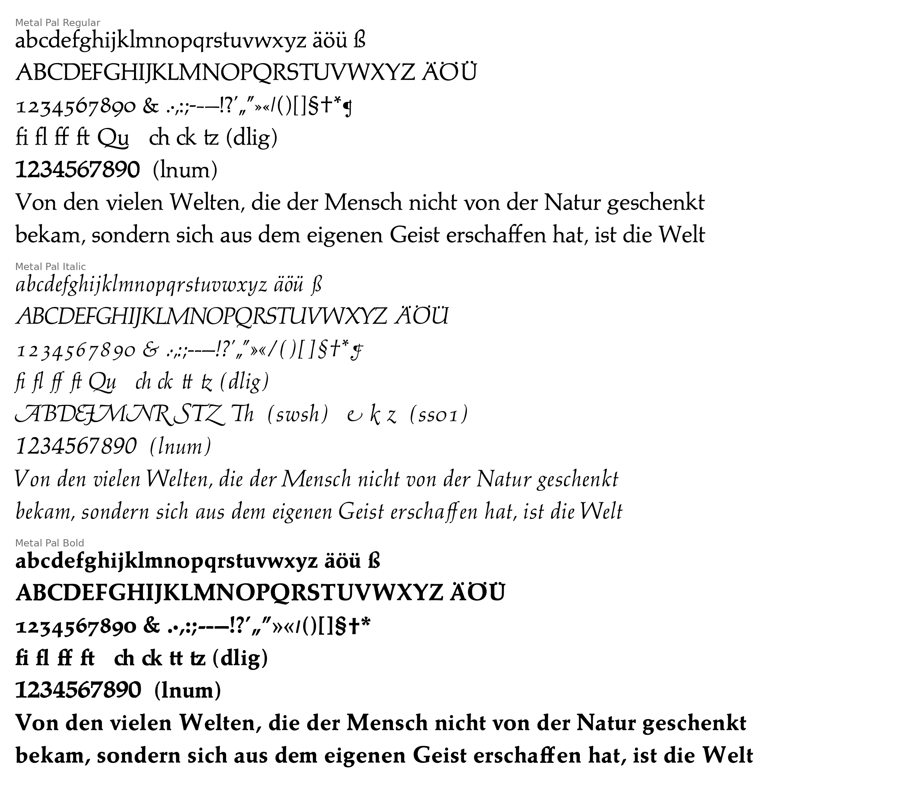
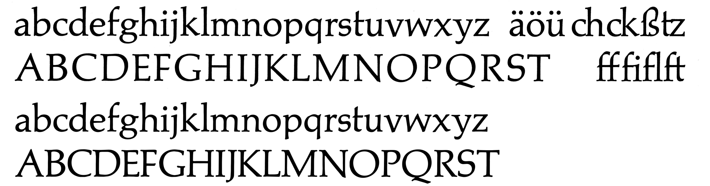
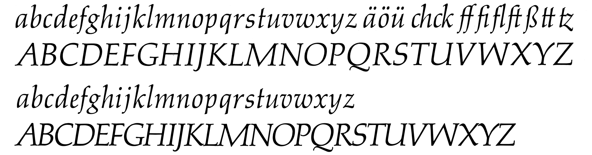
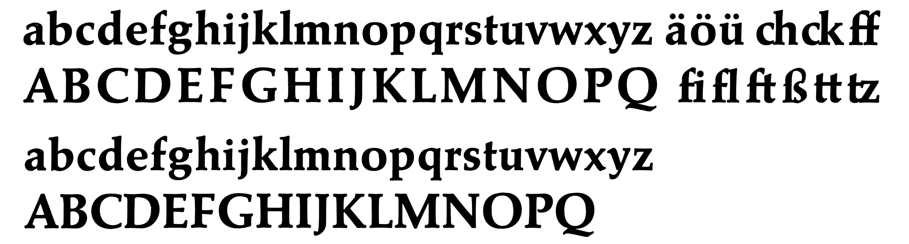

# Metal Pal

Digital fonts traced from the **foundry metal type** of Hermann Zapf's Palatino, as shown on
D. Stempel AG's specimen cards (*Schriftmuster-Karteikarten*), photographed by the
[Letterform Archive](https://www.flickr.com/photos/letterformarchive/albums/72177720310834741/).
The foundry type (first cast 1950–51) differs noticeably from the familiar digital Palatino, which descends from
the later Linotype and phototype versions. Its x-height is smaller (451 units against 469), and its descenders
are short (about −190). The bowls, terminals and serifs are rounder and more calligraphic, and it has the
ligatures and alternates that German hand composition used.



| Font | Source card | Files |
|---|---|---|
| Metal Pal Regular | *Palatino*, St. 2 | `fonts/otf/MetalPal-Regular.otf`, `fonts/ttf/MetalPal-Regular.ttf` |
| Metal Pal Italic | *Palatino-Kursiv*, St. 43 | `fonts/otf/MetalPal-Italic.otf`, `fonts/ttf/MetalPal-Italic.ttf` |
| Metal Pal Bold | *Halbfette Palatino*, St. 44 | `fonts/otf/MetalPal-Bold.otf`, `fonts/ttf/MetalPal-Bold.ttf` |

There is no Bold Italic, because Stempel didn't make one. Each card lists the other weights cast to go with
it (*weitere Garnituren*). The roman lists *Kursiv, Kursiv-Schwungversalien, Kursiv-Linotype, halbfett*, and the
bold lists *magere, Kursiv, Kursiv-Schwungversalien, Kursiv-Linotype*. Neither lists a *halbfette Kursiv*.

The `.otf` files have the fitted cubic Béziers, and the `.ttf` files are converted to quadratics with integer
coordinates. The fonts have 1000 units per em, with the cap height at 692, as in digital Palatino, so the two
can be set at the same size.

## Character set and features

Each style has every character on its card: a–z, A–Z, ä ö ü Ä Ö Ü ß, the figures, `& . · , : ; - ⹀ — ! ? ’ „ “ » « / ( ) [ ] § † * ¶`
(no ¶ in the Bold, which doesn't show one), and the accented letters on the card's *Akzente* line:
á à â é è ê ë í ì î ï ó ò ô ú ù û ç æ œ É È Ê Ë Ç Æ Œ.
Some characters are put together from parts of the card:

- Á À Â Í Ì Î Ï Ó Ò Ô Ú Ù Û Ý Ÿ ý ÿ ı: the card's own accents on its own letters
- ‘ ' " ” ‚: the card's ’ “ „ shapes. ‹ ›: one chevron of « »
- – (en dash): the em dash with its middle removed. `=` is the German double hyphen ⸗ (U+2E40), as on the cards

The fonts have no ñ, å, ø or other letters whose marks don't appear on the cards.

| Feature | What it does |
|---|---|
| default figures | old-style figures, on an en (500-unit) body as cast (*Zifferndicke: Halbgeviert*) |
| `lnum` | lining figures (the cards' *Sonderziffern*) |
| `liga` | fi fl ff ft, and the Qu ligature |
| `dlig` | ch ck tz (and tt in Italic and Bold): the German composing-room ligatures. Italic: the Th swash ligature |
| `swsh` (Italic) | the *Zierbuchstaben*: swash A B D E J M N R S T Z, and Th |
| `ss01`, `salt` (Italic) | the alternate e (with a swash end), k and z |

There is no kerning, because metal type had none. Sorts were cast with their side bearings, and the few kerned
sorts (f, j and the italic's long-tailed letters) overhang their bodies here as they did in metal.

## How the fonts are made

Everything is under `tools/` and runs from this directory (`metal-pal/`). The scans aren't in the repository: see
[`scans/README.md`](scans/README.md) for where to download them.

1. **Segmentation** (`tools/segment.py`, `tools/sheets.py`). Each character sheet is a photograph of about
   9900 × 7000 pixels, with a cap height of about 352 px. Each line of the *Drucktypenverzeichnis* (the type list)
   is split into connected components. Components that overlap horizontally are grouped, which joins i and its
   dot, ä and its dots, and so on. `sheets.py` maps the numbered groups to glyph names, and merges groups where
   the automatic grouping falls short (italic dots, quotation marks, guillemets).
   `python3 tools/extract.py contact` draws the numbered groups.
2. **Rasters in font units** (`tools/extract.py`). A RANSAC line through the letters' bottoms gives each line's
   baseline. The median height of H I E F L T Z gives the cap height, and the scale makes it 692 units (about
   1.96 units per pixel). Each glyph is cut out by its own components, so a kerned italic f doesn't take in its
   neighbours, and is resampled to 1 unit per pixel. The *Akzente* line and the lining figures are a smaller size.
   They are scaled to the main size's x-height, and thinned to its stroke weight (`build.py`).
3. **Tracing** (`tools/trace.py`). The iso-line at 50% ink of the lightly blurred raster gives sub-pixel outlines.
   Each contour is smoothed between its corners, so the paper's ragged edges go and the serifs stay sharp. It is
   then fitted with straight lines and cubic Béziers within 2.5 units, using the corner detection and Schneider
   fitting from [highway-61-revisited](https://github.com/e-n-f/highway-61-revisited)
   (`highway61/work/vec.py` and the corner-preserving smoothing of `mkfont.py`). Curves are split at their extremes.
4. **Spacing** (`tools/spacing.py`). In metal type, two sorts set side by side leave a gap between their inks of
   exactly the right side bearing of the first plus the left side bearing of the second. So each adjacent pair is
   one equation for those two bearings. Pairs come from the sheets' solid runs and from the display lines
   (14–48 p) on each card's other side, which are matched letter by letter to their known text. Ligature sorts
   are recognised by width. The display lines are scaled to font units by their letters' own widths. Least squares
   solves for all the side bearings at once, with these extra terms:
   - a tracking term for each display line and for each run except the reference a–z (the cards letterspace
     their capitals by about 0.06–0.08 em);
   - weak priors: symmetric letters have equal sides, c e and O-shaped capitals share the left side of o and O,
     and every bearing is pulled weakly towards a typical value;
   - outlier rejection.

   Fitting all 180–220 pairs per style leaves a residual of 3–7 units. Roman and bold side bearings are kept
   non-negative except for kerned sorts.
5. **Assembly** (`tools/build.py`). The script builds the accented letters, derived glyphs and OpenType features,
   then writes the OTF and TTF files with fontTools.

```
pip install -r requirements.txt
python3 tools/extract.py      # build/raster-<Style>.pkl (about 10 s)
python3 tools/spacing.py      # build/spacing-<Style>.json
python3 tools/build.py        # fonts/otf, fonts/ttf (a few minutes)
python3 tools/specimen.py     # specimen/
```

### Checking against the scans

`specimen/compare-<Style>.png` shows the scan's type list (top) above the same letters set in the font at the
same cap height (bottom). The lower case lines up with the scan. The capitals are tighter than on the card,
because the card letterspaces them.





## Limitations

- The outlines are the type as printed on the specimen cards, with its ink spread. Nothing is "corrected"
  towards the drawings.
- Each style comes from one size, the one on its card's type list. Metal type was cut
  separately for each size, so text sizes were somewhat wider and heavier.
- The accents, æ œ Æ Œ and the lining figures come from a smaller size on the card, and are scaled up.
- Spacing in pairs that rarely or never appear in the specimens rests partly on the priors. The italic's lower
  case is spaced as on its card, which is looser than the italic in the display lines (by 11–49 units in each gap).
- There is no hinting.

The fonts are called *Metal Pal* because *Palatino* is a trademark of Monotype (Linotype). The name Palatino
appears here only to identify the historical type the fonts are traced from. This project is not affiliated
with the trademark owner.
